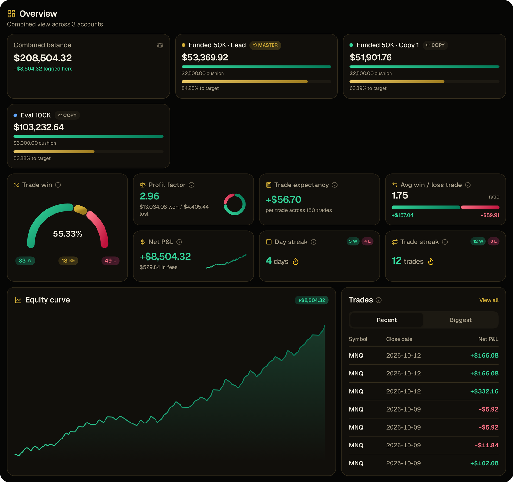
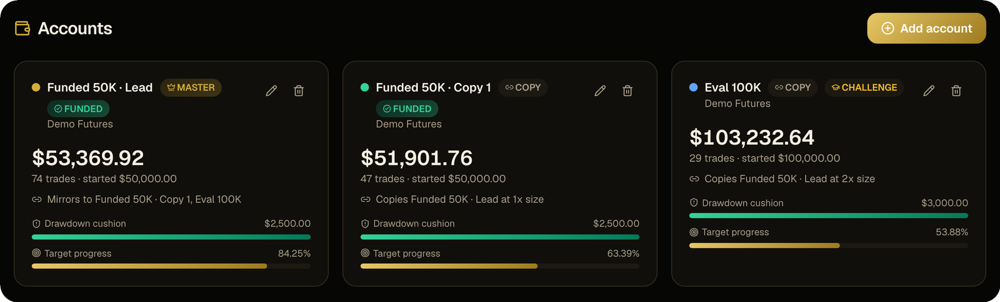
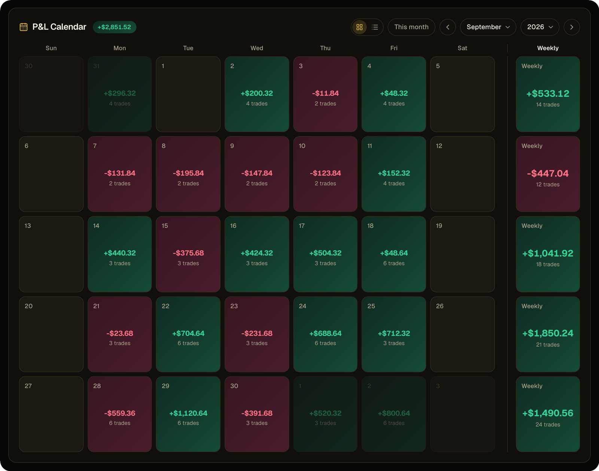
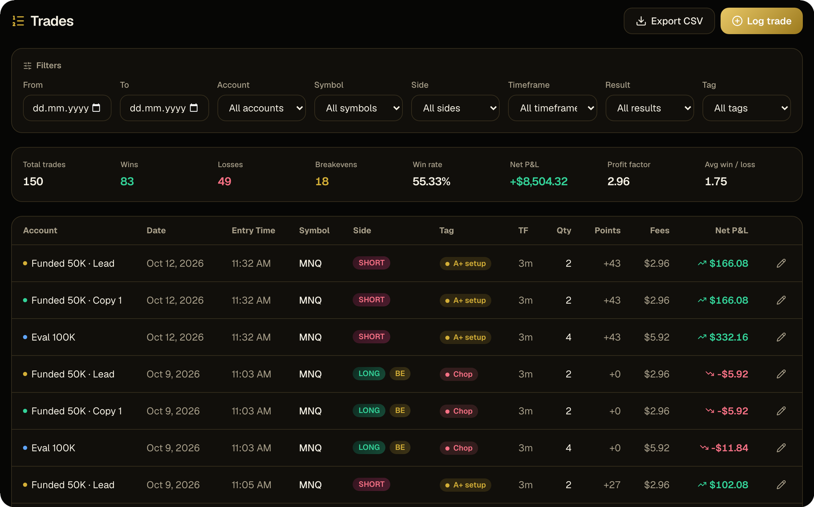
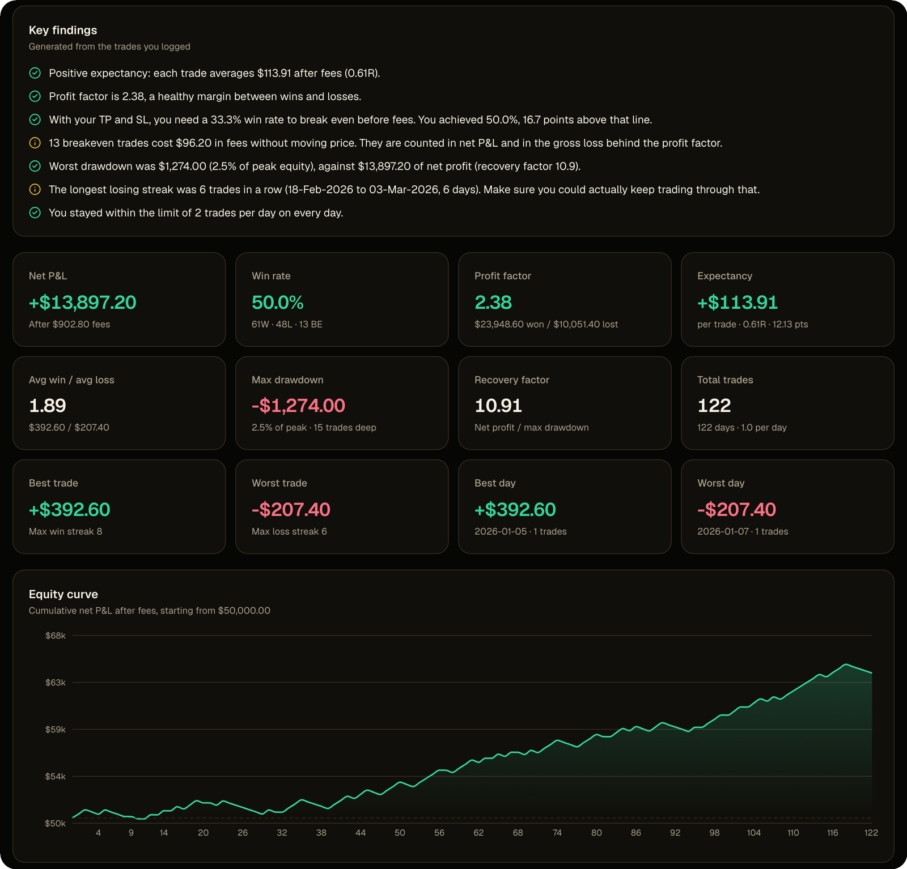
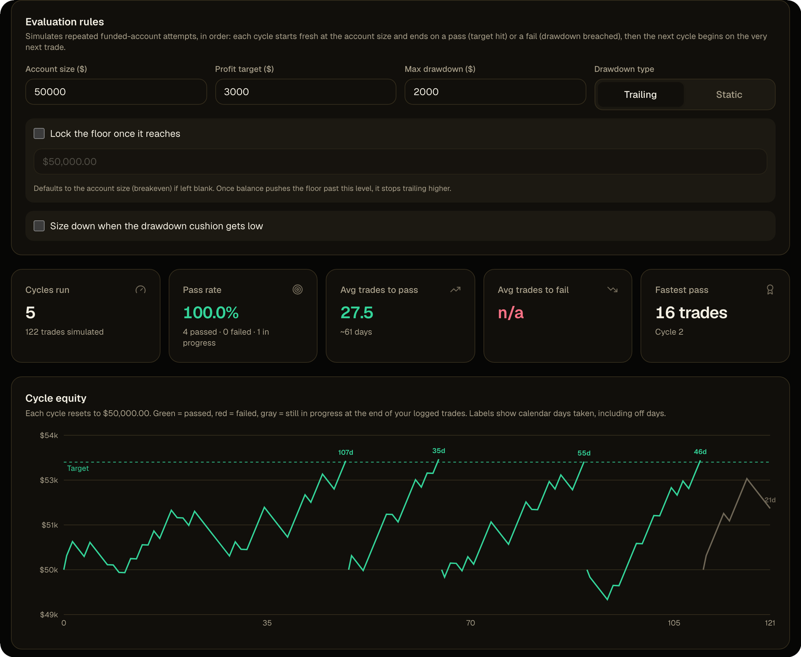
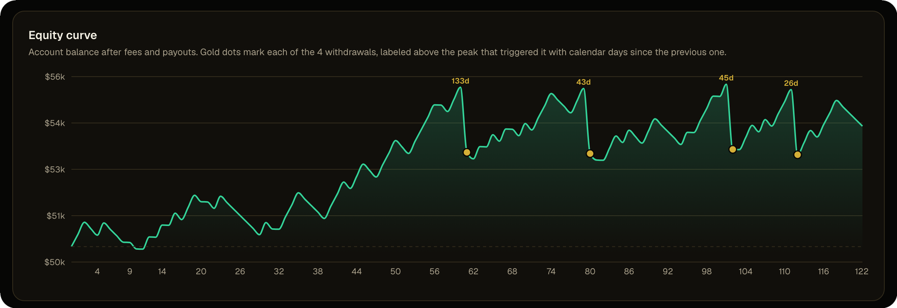
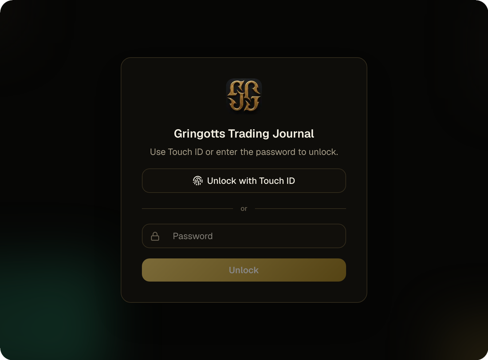

<div align="center">


# Gringotts Trading Journal

**A local-first futures trading journal that guards your data like a vault.**

Track every prop-firm account, copy a trade across all of them in one click,
and backtest your strategy all the way to the payout. Nothing ever leaves your machine.

<br />


<br />



<sub>All screenshots in this README use fictional demo data.</sub>

</div>

<br />

## What is it?

If you trade futures across several prop-firm or broker accounts, you know the
mess: one spreadsheet per account, a drawdown limit you have to compute by hand,
and no honest answer to *"would this strategy actually pay out?"*

Gringotts is one place for all of it:

- **Journal** every trade, on every account, with the right P&L maths for common futures contracts.
- **Watch** your trailing-drawdown cushion and progress to target on every account at once.
- **Backtest** a strategy, then run it through simulated funded evaluations and multi-account payouts.
- **Keep it private.** Your data lives in a single SQLite file on your own machine, behind a lock screen.

<br />

## Feature tour

### Every account at a glance

The dashboard combines all your accounts, or any selection of them, into one view:
balance, **drawdown cushion**, **progress to profit target**, win rate, profit factor,
expectancy, average win vs. loss, day and trade streaks, and the equity curve.

<br />

### Log a trade once. It lands on every account.

Create standalone, **master** and **follower** accounts, each with its own starting balance,
trailing drawdown (with an optional lock), and profit target. Log a trade on the master and it
is copied to every follower, scaled by that follower's size ratio. Edit or delete the master
trade and every copy follows.

<p align="center">
  
</p>

<br />

### Your month as a P&L heatmap

A monthly calendar colours every day green or red by its net P&L, with a weekly total on the
side. Click a day to open its trades or log a new one, or switch to the list view for a running
month-to-date total.

<p align="center">
  
</p>

<br />

### A trade log you can actually filter

Filter by date, account, symbol, side, timeframe, result and tag. Contract maths for common futures
(ES, NQ, MNQ, CL, GC and more) is automatic. Mark breakevens, add tags and notes, and export
to CSV.

<p align="center">
  
</p>

<br />

### Backtest, with a plain-English verdict

Define a strategy (symbol, take-profit and stop, or a reward-to-risk multiple, max trades per day,
fees), log or import its backtested trades, and get a full analysis:

- **Key findings** written out in plain language
- Expectancy, profit factor, drawdown and recovery factor
- Losing streaks, plus breakdowns by weekday, hour, month, long vs. short and exit type
- **What-if sizing:** re-price the same backtest with a different symbol, contract count or fee
- Optional ATR per trade, and CSV / JSON import and export

<p align="center">
  
</p>

<br />

### Eval Sim: would you have passed?

Replay your backtest through repeated funded-account evaluations. Set the account size, profit
target and max drawdown (trailing or static, with an optional lock) and see how many attempts
would have **passed or failed**, how many trades and days each took, and how it all played out
cycle by cycle. You can even simulate sizing down to a smaller contract when your drawdown cushion
gets thin, or compare two strategies side by side.

<p align="center">
  
</p>

<br />

### Multi-Accounts Sim: follow the money to the payout

Split a strategy's trades across groups of accounts and see how each account would have lived
through only a slice of the sequence, which usually means a shallower drawdown. Switch on
**payouts** (target, minimum buffer, profit split) and every withdrawal shows up as a gold dot on
the equity curve, labelled with the days since the previous one.

<p align="center">
  
</p>

<br />

### Private by design

There is no cloud, no account and no sync. Your journal is one SQLite file on your own
disk, and the app opens behind a lock screen. The Mac app adds **Touch ID**.

<p align="center">
  
</p>

You can also export everything to a single JSON backup (and import it on another machine), switch
between dark and light themes, and set your own timezone and breakeven-handling rules in Settings.

<br />

## Getting started

**Requirements:** Node.js 20 or newer.

```bash
git clone https://github.com/csngh/tradingjournal.git
cd tradingjournal
npm install
npm run dev
```

Open [http://localhost:3000](http://localhost:3000). The database is created and migrated
automatically on first run, in `data/trade-journal.db`.

> **About the lock screen:** the app starts on an unlock screen. Its credentials are defined in
> [`src/lib/auth.ts`](src/lib/auth.ts) and [`src/lib/session.ts`](src/lib/session.ts).

<br />

## The Mac app

Gringotts also ships as a native macOS app (Apple Silicon), with Touch ID unlock.

```bash
npm run dist:mac:dmg
```

The DMG lands in `release/`. It is ad-hoc signed by default, so macOS asks you to approve it on
first launch; a *READ ME FIRST* file inside the DMG walks you through it. The Mac app keeps its
database in `~/Library/Application Support/GringottsTradingJournal`, separate from the
development database.

<br />

## Scripts

| Command | What it does |
| --- | --- |
| `npm run dev` | Start the app in development at `localhost:3000` |
| `npm run build` / `npm start` | Production build and server |
| `npm run lint` | Lint the codebase |
| `npm run dist:mac:dmg` | Build the shareable Apple Silicon DMG |
| `npm run dist:mac` | Build the unpacked `.app` for testing |
| `npx drizzle-kit generate` | Generate a migration after changing `src/db/schema.ts` |

<br />

## Built with

[Next.js](https://nextjs.org) (App Router) · [React](https://react.dev) · TypeScript · Tailwind CSS ·
[Drizzle ORM](https://orm.drizzle.team) over SQLite (`better-sqlite3`) · [Recharts](https://recharts.org) ·
[Electron](https://www.electronjs.org)

```
src/app         routes and server actions
src/components  UI, including the dashboard, calendar and simulators
src/db          schema and the SQLite connection (migrations run automatically)
src/lib         metrics, backtest analysis, eval and payout simulation, CSV and backup
drizzle         generated SQL migrations (commit these with schema changes)
electron        the Mac app's main process
scripts         Mac packaging pipeline
```

### Data model

Six tables, all in one local file: `accounts`, `trades`, `tags`, `app_settings`, `strategies` and
`backtest_trades`. A follower account references its master through `masterId`, and trades logged
on a master share a `copyGroupId`, which is how editing or deleting the master trade keeps every
follower's copy in sync.

<br />

<div align="center">

Made with ❤️ by Bros for Bros.

</div>
